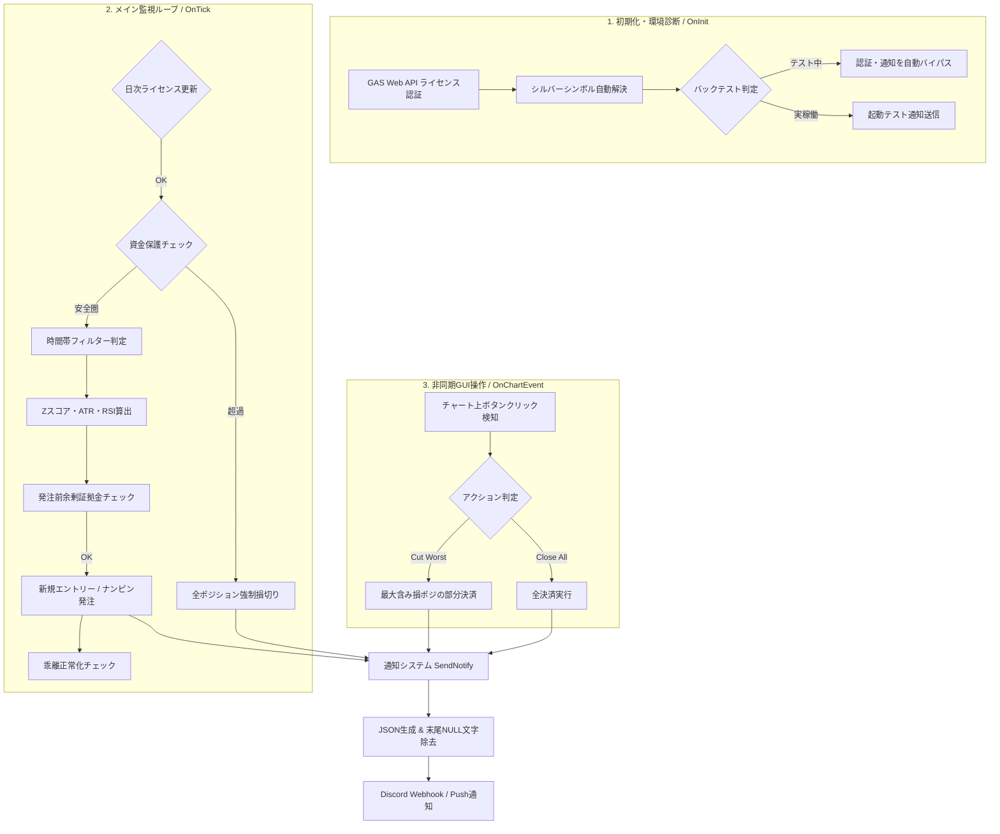

# MIDAS-Gold-Silver-Arbitrage-EA (v7.05)
### 統計的異銘柄相関・異常値検知 自動売買システム（Zスコア平均回帰 ＆ 資金保護プロテクター）


MetaTrader 4 (MT4) 上で動作する、金（XAUUSD）と銀（XAGUSD）の価格連動性に着目した統計的アルゴリズム取引システム（EA）です。  
強い正の相関を持つ2資産の価格比率をリアルタイムに監視し、統計学の「Zスコア（標準化スコア）」を用いて一時的な価格の歪み（外れ値）を検知。平均回帰を狙った逆張りエントリーから、自動ナンピン防衛、エクイティ・プロテクターによる強制破綻防止までを全自動で実行します。

> **※ セキュリティおよび公開コードについて**  
> 本リポジトリで公開しているソースコードは実運用環境で稼働しているプロダクト（v7.05）のフルコードですが、セキュリティ保護の観点から、外部認証サーバー（Google Apps Script Web API）のエンドポイントIDのみプレースホルダーに置換しています。

---

## 📸 実運用・稼働イメージ

### 1. MT4稼働画面 ＆ リアルタイムダッシュボード（GUI操作パネル）


### 2. Discordへのリアルタイム通知（エラー回避・JSON送信）


### 3. 長期バックテスト（ストラテジーテスター検証結果）


## 🏗 システムアーキテクチャ

MT4の主要イベントハンドラ（`OnInit` / `OnTick` / `OnTimer` / `OnChartEvent`）を軸に、状態監視・統計計算・外部API通信を非同期に連携させています。


## ⚙️ コアロジックとアルゴリズム設計

### 1. 異銘柄間のリアルタイム統計処理（`CalculateZScoreStats()`）

強い正の相関を持つ金（XAUUSD）と銀（XAGUSD）の価格比率（金価格 ÷ 銀価格）を毎ティック取得します。

* 直近N期間（デフォルト60本）の移動平均と標準偏差を算出し、現在の価格比率の歪み度合いを示すZスコア（標準化スコア）をリアルタイムに計算します。
* 突発的な要因で一時的に相関バランスが崩れた「統計的な外れ値（Zスコアの絶対値が3.0以上）」を検知し、価格が元のバランスに収束する力（平均回帰）を狙って逆張りエントリーを行います。

### 2. マルチフィルターによるスコアリング判定（`CheckEntry()`）

Zスコアの異常値単体に依存せず、以下の複数条件を組み合わせたスコアリング方式を採用しています。

* **大局トレンドフィルター**: 長期移動平均線（200日SMA）によるトレンド方向の整合性確認。
* **ボラティリティフィルター**: ATR（平均真の値幅）を用いた回帰乖離の閾値調整。
* **モメンタムフィルター**: RSIによる買われすぎ・売られすぎゾーンの判定。複数の根拠が合致した時のみ発注を行うことで、ダマシを大幅に排除しています。

### 3. 多重防衛リスク管理（エクイティ・プロテクター ＆ 建値撤退）

* **エクイティ・プロテクター (`CheckEquityProtection()`)**: 口座のバランスと有効証拠金を常時監視し、設定した許容最大ドローダウン率（初期値45%）に達した瞬間に全ポジションを強制損切り。最悪のシナリオ（口座破産）を未然に防止します。
* **乖離正常化時の自動建値撤退 (`CheckBreakevenOnConvergence()`)**: エントリー後に価格が伸び悩んだままZスコアが正常値に復帰した場合、「平均回帰の優位性が消滅した」と判断し、自動的にストップロスを注文価格＋微益に移動してリスクゼロで撤退します。

## 💡 技術的な工夫・エンジニアリングハイライト

### 1. MQL4のメモリ仕様に起因する Discord API の HTTP 400 エラー対策

* **課題**: `WebRequest` 関数を用いてDiscordへJSONデータをPOST送信する際、サーバー側から「HTTP 400（Bad Request）」が返され、通知が機能しない問題に直面。
* **解決策**:
* MQL4の文字列変換関数 `StringToCharArray` がUTF-8バイト配列の末尾に自動付与するC言語特有のNULL終端文字（`\0`）が、Discord側の厳格なJSONパーサーに拒絶されている原因を特定。
* 送信直前に `ArrayResize(postData, ArraySize(postData) - 1)` を実行し、**バイト配列のサイズを1バイト縮小して末尾のNULL文字を物理的に切り落とす処理**を実装。これによりHTTP 204（通信成功）を安定取得。


### 2. ブローカー依存を解消するシンボル名自動解決アルゴリズム

* **課題**: 海外FX業者ごとに異なる銀の銘柄命名規則（`XAGUSD`, `SILVER`, `XAGUSDm`, `XAGUSD.pro` など）に対応する必要がある。
* **解決策**:
* ゴールドのチャート名からサフィックス（接尾辞）を動的抽出するスマート探索ロジックに加え、主要ベース名と各種サフィックスを組み合わせた2重ループによる総当たり探索（`AutoDetectSilverSymbol()`）を実装。有効な気配値を持つシンボルを自動特定し、ユーザーの設定ミスを防ぐ堅牢な初期化処理を実現。


### 3. イベント駆動型の独立タイマーUIと安全な証拠金チェック

* 価格変動に依存せず `EventSetTimer(1)` により1秒周期でダッシュボードを独立更新し、低ボラティリティ時でも画面がフリーズしない高いUI応答性を確保。また、新規発注やナンピンの直前に必ず `AccountFreeMarginCheck` を挟むことで、証拠金不足によるエラーの無限連打（サーバー負荷）を完全に排除。

## 🛠 開発プロセス（Development Methodology）

本システムは、実運用における統計的裁定取引の自動化と堅牢なリスク管理を目的とし、AI-Assisted Development（生成AIをペアプログラマーとして活用した開発手法）を取り入れて開発しました。

* **要件定義・アルゴリズム設計**:
異銘柄間の相関分析におけるZスコア算出ロジックや、マクロトレンド発生時の破綻を防ぐエクイティ・プロテクターの必要性を定義し、安全設計を構築。
* **実装・プロトタイピング**:
MQL4のタイマー制御（`OnTimer`）やオブジェクト描画、低レイヤなバイト配列制御（`ArrayResize` によるNULL文字除去）の実装にLLMを活用し、開発を加速。
* **デバッグ・品質改善**:
Discord Webhook通信時のHTTP 400エラー解析や、ブローカーごとの異なるシンボル命名規則に対する総当たり探索アルゴリズムの導入を主導して解決。

## 📋 主要関数リファレンス

| 関数名 | 役割・処理内容 |
| --- | --- |
| `CheckWebAuthentication()` | 外部Web API（GAS）へGETリクエストを送りオンライン認証を行う（日次キャッシュ・3回リトライ付き）。 |
| `AutoDetectSilverSymbol()` | 稼働中のゴールドの銘柄名とサフィックスを解析し、ブローカー固有の銀シンボルを自動特定する。 |
| `CalculateZScoreStats(...)` | 指定期間の金・銀の価格比率から移動平均と標準偏差を算出し、Zスコアを導出する。 |
| `CheckEntry()` | Zスコア、大局MAトレンド、ATR、RSIを組み合わせたマルチフィルターによる発注判定を行う。 |
| `ManagePositions()` | 利益確定、トレーリングストップ、および条件を満たした際のナンピン追加発注を統括する。 |
| `CheckBreakevenOnConvergence()` | 乖離解消（Zスコア正常化）時に、保有ポジションのストップロスを建値（微益）に移動してリスクヘッジする。 |
| `CheckEquityProtection()` | 口座の有効証拠金を常時監視し、設定した最大ドローダウン超過時に全ポジションを強制損切りする。 |
| `SendNotify(string message)` | プッシュ通知およびDiscord Webhook（NULL文字除去処理付きJSON POST）による統合通知を行う。 |
| `OnChartEvent(...)` | チャート上の緊急ボタン（全決済・最大含み損部分決済）のクリックを非同期に検知して実行する。 |
| `UpdateDashboard()` | チャート上にリアルタイムのレシオ、Zスコア、RSI、システム稼働状態を描画する。 |

📁 ディレクトリ構成
```Plaintext
MIDAS-Gold-Silver-Arbitrage-EA/
│
├── assets/                        # 実運用・検証スクリーンショット格納用
│   ├── midas_dashboard_ui.png     # MT4稼働画面・リアルタイムダッシュボード
│   ├── midas_discord_notify.png   # Discordへの非同期通知プレビュー
│   └── midas_backtest_result.png  # 長期バックテスト検証結果
│
├── src/
│   └── Gold_Silver_Anomaly_EA.mq4 # メインソースコード（v7.05 / 認証IDマスク済）
│
└── README.md                      # システム仕様・アーキテクチャ設計書
